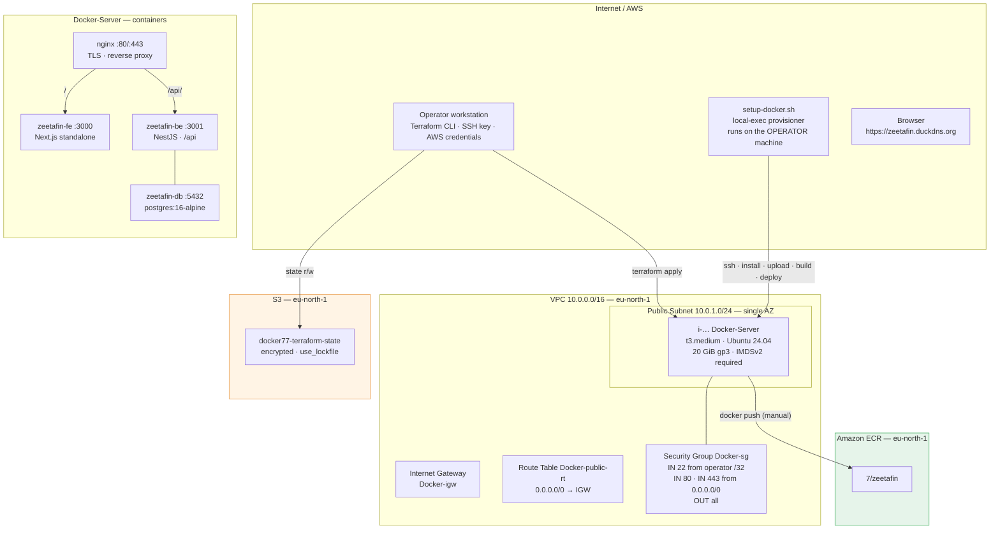

# ZeetaFin on AWS — Single-Host Docker Deployment with ECR

Provision one Ubuntu 24.04 EC2 host with Terraform, then drive it with a Bash bootstrap from
the operator machine until a real application is **live over HTTPS in a browser** — and stop
exactly where AWS credentials become unavoidable.

| | |
|---|---|
| **Cloud** | AWS, `eu-north-1` (Stockholm) |
| **Host** | `Docker-Server`, 1 × `t3.medium`, 20 GiB gp3, IMDSv2 required |
| **App** | ZeetaFin — NestJS backend, Next.js frontend, PostgreSQL 16 |
| **Edge** | nginx reverse proxy + Let's Encrypt certificate on `zeetafin.duckdns.org` |
| **Registry** | Amazon ECR `7/zeetafin`, mutable tags |
| **Automation** | `terraform apply` → provision → bootstrap → **live site** |
| **Manual** | `aws configure` + `docker push` (credentials that must not live in Terraform) |

Everything is declared in HCL. There are no hard-coded instance IDs, no manual console
clicks, and no per-host divergence. The only actions a human performs are the two that
require credentials.

> **Status:** functionally complete and applied. The Terraform root module passes
> `terraform validate` and `terraform fmt` is clean. This repository is published for
> **public technical review**; see [Known Issues](docs/KNOWN-ISSUES.md) for a frank list of
> defects that reviewers are explicitly invited to critique, and
> [Security](docs/SECURITY.md) for the threat model.

---

## Table of Contents

- [What This Builds](#what-this-builds)
- [Architecture at a Glance](#architecture-at-a-glance)
- [The Three-Stage Bootstrap Model](#the-three-stage-bootstrap-model)
- [Repository Layout](#repository-layout)
- [Prerequisites](#prerequisites)
- [Quick Start](#quick-start)
- [Configuration Reference](#configuration-reference)
- [Outputs Reference](#outputs-reference)
- [Verification](#verification)
- [Cost](#cost)
- [Design Decisions and Alternatives Rejected](#design-decisions-and-alternatives-rejected)
- [Evidence](#evidence)
- [Documentation Index](#documentation-index)
- [Known Issues](#known-issues)
- [Contributing](#contributing)
- [License](#license)

---

## What this builds



### Network path summary

| Flow | Protocol | Path |
|---|---|---|
| Operator → host | SSH/22 | Internet → IGW → public RT → host public IP. Operator `/32` only. |
| Browser → host | HTTPS/443 | Internet → IGW → host → nginx. The only public entry point. |
| Browser → host | HTTP/80 | ACME HTTP-01 challenge and HTTP→HTTPS redirect. |
| Host → Internet | HTTPS/443 | Egress. `apt`, Docker Hub, the npm registry, DuckDNS, ECR, Let's Encrypt. |
| nginx → app | HTTP/3000, 3001 | Loopback only. Containers bind `127.0.0.1`. |
| backend → database | TCP/5432 | Docker network `zeetafin-net`. **Not published.** |

---

## Architecture at a glance

| Resource | Type | File | Key detail |
|---|---|---|---|
| `terraform` block | backend `s3` | `providers.tf` | Bucket `docker77-terraform-state`, `encrypt = true`, `use_lockfile = true` |
| `provider.aws` / `provider.http` | providers | `providers.tf` | `http` exists solely for `data.http.my_ip` |
| `data.aws_availability_zones.available` | data source | `networking.tf` | Ordered, not sorted; only `names[0]` used |
| `aws_vpc.main` | VPC | `networking.tf` | `cidr_block = var.vpc_cidr`, `enable_dns_hostnames = true` |
| `aws_internet_gateway.igw` | IGW | `networking.tf` | Attached through the public route table |
| `aws_subnet.public` | Subnet | `networking.tf` | `map_public_ip_on_launch = true`, single AZ |
| `aws_route_table.public` | Route table | `networking.tf` | `0.0.0.0/0 → IGW` |
| `aws_route_table_association.public` | Association | `networking.tf` | Subnet ↔ route table |
| `aws_security_group.ec2` | Security group | `firewall.tf` | 22 from operator `/32`; 80/443 from `0.0.0.0/0`; egress all |
| `data.http.my_ip` | data source | `firewall.tf` | `https://checkip.amazonaws.com` → operator `/32` |
| `aws_key_pair.docker` | Key pair | `firewall.tf` | `key_name = "${var.project}-key"` → `Docker-key` |
| `data.aws_ssm_parameter.ubuntu` | data source | `compute.tf` | Canonical `24.04/stable/…/ebs-gp3` AMI |
| `aws_instance.docker` | Instance | `compute.tf` | IMDSv2 required, 20 GiB gp3 encrypted |
| `aws_ecr_repository.zeetafin` | ECR repository | `ecr.tf` | `7/zeetafin`, `image_tag_mutability`, `force_delete` |
| `terraform_data.bootstrap` | Provisioner trigger | `bootstrap.tf` | `triggers_replace` on host IP, domain, `app_source_revision`, plus `filesha256` of script, `deploy.sh`, `nginx.cfg` |
| `local-exec` provisioner | Provisioner | `bootstrap.tf` | `bash ./setup-docker.sh`, `working_dir = path.module` |

**10 managed resources, 3 data sources.**

The `remote_state/` subdirectory is a **separate, self-contained root module** whose only job
is to create the S3 bucket `Infrastructure/` depends on. It has **no backend of its own**
(the bootstrap paradox), no variables and no `.tfvars` — the bucket name and region are
literals in `main.tf`, because the `backend` block cannot read `var.*`. Its state is local;
see [KI-06](docs/KNOWN-ISSUES.md#ki-06).

---

## The three-stage bootstrap model

This is the part most worth reviewing, because the boundary between the stages is a design
decision, not an accident. The bootstrap runs **eight** steps.

### Stage 1 — Terraform provisions (`networking.tf`, `firewall.tf`, `compute.tf`, `ecr.tf`)

Terraform creates the VPC, IGW, subnet, route table and association, the security group, the
key pair and the instance, then the ECR repository. It stops there: it installs **no**
software and never sees the application source.

### Stage 2 — Bash bootstraps (`setup-docker.sh`)

A `local-exec` provisioner on `terraform_data.bootstrap` runs the script **on the operator
machine**. It drives the host over SSH through eight numbered steps:

1. **Resolve target** — host IP, SSH user and key. `resolve_key()` bridges Windows
   `C:\Users\…` paths to the forms Bash understands; the key is copied to a `chmod 700`
   temp dir, `chmod 600`s, and verified with `ssh-keygen -y`.
2. **Wait for SSH** — up to 30 × 10 s.
3. **Install tooling** — Docker CE (GPG-verified apt repo), AWS CLI v2, nginx,
   certbot, openssl, unzip; the login user is added to the `docker` group so later steps
   (and day-2 work) run Docker without `sudo`.
4. **Upload source** — pack the local `Application/Backend/ZeetaFin-BE` and
   `Application/Frontend/ZeetaFin-FE` trees into tarballs (excluding `.git`, `node_modules`,
   `.next`, build output and `.env`), `scp` them to the host and extract them into
   `~/zeetafin/`. The tree in this repository is the source of truth, so nothing is ever cloned
   from a remote.
5. **Secrets + deploy script** — push `deploy.sh`, then generate `POSTGRES_PASSWORD` and
   `JWT_SECRET` with `openssl rand` and upload a `0600` `.env` **only if one is not already
   present** (pass `-f` to force a rotation), so re-runs keep the secrets the running
   database already uses.
6. **Build** — `docker build` both images on the host.
7. **Deploy** — `deploy.sh` recreates PostgreSQL, waits for it, recreates the backend and
   frontend, and polls until the API answers.
8. **nginx + TLS** — install the site config (first run only), update DuckDNS (if a token is
   set), then `certbot --nginx` — reusing an existing certificate rather than reissuing —
   and finally print the `ecr_push_commands` block.

### Stage 3 — `aws configure` + ECR push (manual)

The site is already live. The final step puts the images in ECR, and it is **deliberately
left to you** because it needs AWS credentials that must never live in Terraform or on the
host by default. See [SECURITY.md § S1](docs/SECURITY.md) and
[KI-15](docs/KNOWN-ISSUES.md#ki-15).

### Why Bash and not Ansible this time?

Phase 1 used Ansible for a two-node fleet. Here there is **one** host, and the workload is
imperative by nature (`scp`, `docker build`, `docker run`, `certbot`). Ansible's
fan-out value does not apply and its control-node overhead is pure cost. The bootstrap is
written to be safely re-runnable: secrets are preserved across runs and the nginx/TLS steps
are idempotent.

---

## Repository layout

```text
.
├── README.md                        ← you are here
├── LICENSE                          MIT
├── CONTRIBUTING.md
├── .gitignore                       hardened — see KNOWN-ISSUES § KI-02
├── .gitattributes                   forces LF so the shell scripts survive Windows checkouts
│
├── Infrastructure/                  ← the main root module; run terraform with -chdir
│   ├── .terraform.lock.hcl          provider pins — committed on purpose
│   ├── terraform.tfvars             ← git-ignored, your real values
│   ├── terraform.tfvars.example     ← committed, safe template
│   ├── providers.tf                 terraform block, S3 backend, aws + http providers
│   ├── variables.tf                 all 14 input variables
│   ├── networking.tf                VPC, IGW, subnet, route table, association
│   ├── firewall.tf                  security group, operator-IP lookup, EC2 key pair
│   ├── compute.tf                   Ubuntu AMI lookup, the single instance
│   ├── ecr.tf                       the ECR repository
│   ├── bootstrap.tf                 terraform_data + local-exec provisioner
│   ├── outputs.tf                   10 outputs
│   └── setup-docker.sh              Stage 2 — host bootstrap (Bash, 392 lines)
│
├── Application/                     deploy-time inputs; the application source to ship
│   ├── deploy.sh                    container run commands (postgres + be + fe)
│   ├── nginx.cfg                    nginx site config (server_name substituted at deploy)
│   ├── .env.example                 template for the host's ~/zeetafin/.env
│   ├── Backend/ZeetaFin-BE/         ← tracked backend source (scped to the host)
│   └── Frontend/ZeetaFin-FE/        ← tracked frontend source (scped to the host)
│
├── remote_state/                    ← separate root module: creates the S3 state bucket
│   ├── main.tf                      versioned, encrypted, public access blocked
│   └── outputs.tf
│
├── docs/
│   ├── ARCHITECTURE.md
│   ├── DEPLOYMENT.md
│   ├── OPERATIONS.md
│   ├── SECURITY.md
│   ├── KNOWN-ISSUES.md
│   ├── COST.md
│   └── REVIEW-CHECKLIST.md
│
└── screenshots/                     terminal captures from the working deployment
```

> **The main root module lives in `Infrastructure/`, with a capital `I`.** Every command in
> these docs is written from the repository root as `terraform -chdir=Infrastructure …`.
> `remote_state/` is a **separate** root module with its own local state and is never
> referenced from `Infrastructure/`.

**There is no CI.** Every check documented here is a local command you run yourself — see
[Verification](#verification) and [CONTRIBUTING.md § Before you open a PR](CONTRIBUTING.md#before-you-open-a-pr).

The application source **is** tracked in this repository. `Application/Backend/ZeetaFin-BE/`
and `Application/Frontend/ZeetaFin-FE/` are the full NestJS and Next.js trees, committed here
next to the infrastructure; they are the **source of truth** and `setup-docker.sh` `scp`s them
to the host, which never runs `git`. Only runtime `.env` files stay out. See
[ARCHITECTURE.md § Application delivery](docs/ARCHITECTURE.md#application-delivery).

---

## Prerequisites

| Requirement | Version | Notes |
|---|---|---|
| Terraform CLI | **≥ 1.10** (1.15.8 used) | `use_lockfile` needs ≥ 1.10. |
| AWS CLI | v2 | Used on the **host** for the ECR push. |
| AWS credentials | — | Anything the AWS provider supports. **Prefer SSO or a role over long-lived keys.** |
| Permissions | — | `ec2:*`, `ecr:*`, `s3:*` on the state bucket. |
| SSH key pair | ed25519 | `~/.ssh/id_ed25519` + `.pub`, created before `apply`. |
| GNU bash | ≥ 4.4 | `setup-docker.sh` runs locally under Git Bash, WSL, Linux or macOS. |
| OpenSSH client | ≥ 8.0 | `ssh`, `scp`, `ssh-keygen`. |
| DuckDNS account | free | To own `zeetafin.duckdns.org` (or your own subdomain). |
| App source | — | Shipped with this repository under `Application/`; `setup-docker.sh` uploads it to the host — no clone, no deploy keys. |

**Generate the SSH key if you have not already:**

```bash
ssh-keygen -t ed25519 -a 100 -C "zeetafin-deploy" -f ~/.ssh/id_ed25519
```

**On Windows**, run everything from **Git Bash** or **WSL.** Terraform's `local-exec` on
Windows cannot export environment variables to a child `bash`, which is why the bootstrap
passes the key as a base64 `-K` argument and `resolve_key()` exists to translate
`C:\Users\…` into a path Bash understands.

---

## Quick start

> Full detail, with expected output and failure diagnosis at every step, is in
> **[docs/DEPLOYMENT.md](docs/DEPLOYMENT.md)**. This is the condensed version.

### Step 0 — Configure

```bash
cp Infrastructure/terraform.tfvars.example Infrastructure/terraform.tfvars
```

Set at minimum:

```hcl
region              = "eu-north-1"
vpc_cidr            = "10.0.0.0/16"
public_subnet_cidr  = "10.0.1.0/24"
instance_type       = "t3.medium"
project             = "Docker"
ecr_namespace       = "7"
ecr_repository_name = "zeetafin"
ssh_user            = "ubuntu"
public_key_file     = "~/.ssh/id_ed25519.pub"
private_key_file    = "~/.ssh/id_ed25519"
duckdns_domain      = "zeetafin.duckdns.org"
duckdns_token       = ""      # optional; set it to point DNS automatically
letsencrypt_email   = ""      # optional; certbot contact
```

> There is no `ssh_cidr` variable. The operator's public IP is resolved at apply time from
> `https://checkip.amazonaws.com` and turned into a `/32`, so moving networks is handled by a
> plain re-apply.

### Step 1 — Bootstrap the state bucket (once per account/region)

```bash
cd remote_state
terraform init
terraform apply -auto-approve
cd ..
```

Expected: an S3 bucket `docker77-terraform-state`, versioned and encrypted, with all four
public-access-block flags set. This module has **no backend** — its state is local. See
[KI-06](docs/KNOWN-ISSUES.md#ki-06).

### Step 2 — Deploy

```bash
terraform -chdir=Infrastructure init
terraform -chdir=Infrastructure plan      # first plan creates 10 resources
terraform -chdir=Infrastructure apply
```

The apply provisions the infrastructure, then runs `setup-docker.sh`, which uploads the local
`Application/` source, builds both images, deploys the containers and obtains the certificate —
**in a single pass.** Make sure `Application/Backend/ZeetaFin-BE/` and
`Application/Frontend/ZeetaFin-FE/` exist locally first; the script aborts at step 4/8 if
either is missing.

To redeploy after editing the application, bump the revision so the bootstrap re-uploads and
rebuilds:

```bash
# edit Infrastructure/terraform.tfvars
app_source_revision = "2"   # any new value
terraform -chdir=Infrastructure apply
```

### Step 3 — Verify

```bash
terraform -chdir=Infrastructure output -raw app_url      # https://zeetafin.duckdns.org
curl -sI https://zeetafin.duckdns.org | head -1          # 200
curl -s  https://zeetafin.duckdns.org/api/ | head
```

Open the URL: the application loads over a valid Let's Encrypt certificate.

### Step 4 — Push the images to ECR (manual)

```bash
ssh -i ~/.ssh/id_ed25519 ubuntu@<server_public_ip>

aws configure     # ECR credentials only
REGISTRY=$(terraform -chdir=Infrastructure output -raw ecr_registry)   # run this locally first
REPO=$(terraform -chdir=Infrastructure output -raw ecr_repository_url)

aws ecr get-login-password --region eu-north-1 | docker login --username AWS --password-stdin "$REGISTRY"
docker tag zeetafin-be:latest "$REPO:backend"  && docker push "$REPO:backend"
docker tag zeetafin-fe:latest "$REPO:frontend" && docker push "$REPO:frontend"
```

`terraform -chdir=Infrastructure output -raw ecr_push_commands` prints the same block with the
real values filled in.

> **Better than `aws configure`:** avoid long-lived keys on the host entirely — see
> [SECURITY.md § S1](docs/SECURITY.md) and [KI-15](docs/KNOWN-ISSUES.md#ki-15).

---

## Configuration reference

All variables live in [`variables.tf`](Infrastructure/variables.tf). Values come from
`Infrastructure/terraform.tfvars`.

| Variable | Type | Default | Required | Description |
|---|---|---|---|---|
| `region` | `string` | — | ✅ | AWS region for the provider and the backend. |
| `vpc_cidr` | `string` | — | ✅ | CIDR for the VPC. |
| `public_subnet_cidr` | `string` | — | ✅ | CIDR for the single public subnet. |
| `instance_type` | `string` | — | ✅ | EC2 instance type. `t3.medium` recommended. |
| `project` | `string` | — | ✅ | Prefix for every `Name` tag and the SG / key-pair names. |
| `ecr_namespace` | `string` | — | ✅ | Namespace prefix for the ECR repository. |
| `ecr_repository_name` | `string` | — | ✅ | Repository name. Full name is `namespace/name`. |
| `public_key_file` | `string` | `~/.ssh/id_ed25519.pub` | ❌ | Uploaded to the EC2 key pair. |
| `private_key_file` | `string` | `~/.ssh/id_ed25519` | ❌ | Used by the local-exec provisioner and the bootstrap. |
| `ssh_user` | `string` | `ubuntu` | ❌ | Login user for the Ubuntu AMI. |
| `app_source_revision` | `string` | `1` | ❌ | Opaque marker for the application source. Bump it to re-upload and rebuild. |
| `duckdns_domain` | `string` | `zeetafin.duckdns.org` | ❌ | Public hostname served by nginx and certified by Let's Encrypt. |
| `duckdns_token` | `string` (sensitive) | `""` | ❌ | When set, the bootstrap updates the DuckDNS record automatically. |
| `letsencrypt_email` | `string` | `""` | ❌ | certbot contact for expiry notices. |

### Changing `instance_type` later

Changing this forces **replacement** of the instance. The new host gets a new public IP, the
database volume is lost with the old root disk, and the bootstrap re-runs from scratch. Plan
for an outage, back up the database, and re-apply. See
[OPERATIONS.md § Replacing the host](docs/OPERATIONS.md#replacing-the-host).

---

## Outputs reference

| Output | Meaning |
|---|---|
| `server_public_ip` | Public IP of the Docker host. |
| `ssh_user` | Login user. |
| `ssh_command` | Ready-to-paste SSH command. |
| `app_url` | `https://<duckdns_domain>`. |
| `key_name` | EC2 key pair name (`Docker-key`). |
| `private_key_file` | Echo of the input variable. |
| `ecr_repository_name` | `7/zeetafin`. |
| `ecr_repository_url` | Full repository URL (registry + name). |
| `ecr_registry` | Registry hostname for `docker login`. |
| `ecr_push_commands` | The manual tag/push block, pre-filled. |

```bash
terraform -chdir=Infrastructure output                 # all outputs
terraform -chdir=Infrastructure output -json           # machine-readable
terraform -chdir=Infrastructure output -raw server_public_ip
```

---

## Verification

### Terraform-side

```bash
terraform fmt -check -recursive                         # no output = formatted
terraform -chdir=Infrastructure validate                # Success!
terraform -chdir=Infrastructure state list              # 10 resources
terraform -chdir=Infrastructure plan                    # "No changes" = converged
```

### Host-side

```bash
ssh -i ~/.ssh/id_ed25519 ubuntu@$(terraform -chdir=Infrastructure output -raw server_public_ip)
docker ps --format 'table {{.Names}}\t{{.Status}}\t{{.Ports}}'
docker logs --tail 40 zeetafin-be
sudo nginx -t
sudo certbot certificates
```

### Site-side

```bash
dig +short zeetafin.duckdns.org
curl -sI https://zeetafin.duckdns.org | head -1
curl -s  https://zeetafin.duckdns.org/api/ | head
```

### Registry-side

```bash
aws ecr describe-images --repository-name 7/zeetafin \
  --query 'sort_by(imageDetails, &imagePushedAt)[*].[imageTags[0], imageSizeInBytes]' \
  --output table
```

---

## Cost

Full model in **[docs/COST.md](docs/COST.md)**. Summary at `eu-north-1` list prices:

| Scenario | Monthly |
|---|---|
| Running 24×7 | **≈ $39** |
| Running 8 h/day, weekdays only | **≈ $10** |
| Destroyed | **$0** |

The `t3.medium` is the bulk of it (≈ $33/month); the public IPv4 address is ≈ $3.65 and the
20 GiB disk ≈ $1.76. DuckDNS and Let's Encrypt are free. The cheapest option
is to destroy the stack between sessions — the rebuild is ~15 minutes
([docs/COST.md](docs/COST.md#deciding-when-to-destroy)).

---

## Design decisions and alternatives rejected

| Decision | Rationale | Alternative rejected |
|---|---|---|
| Bash bootstrap, not Ansible | One host; imperative workload; keeps Phase 2 distinct from Phase 1. | Ansible (control-node overhead for one target); EC2 `user_data` (Terraform cannot observe success). |
| Build images on the host | The whole path is visible from one `apply`; no CI secrets to manage. | Build in CI and pull from ECR (the repo already has a workflow) — kept as an alternative, see [KI-12](docs/KNOWN-ISSUES.md#ki-12). |
| Ship the app source over SSH, not a clone | The `Application/` tree is tracked in this repository and is the source of truth, and `scp` still delivers uncommitted files; no deploy keys, no GitHub access, no `git` on the host. | Read-only deploy keys + `git clone` on the host (needs repo admin and a two-pass handshake) — see [KI-10](docs/KNOWN-ISSUES.md#ki-10). |
| Add the login user to the `docker` group | Later bootstrap steps and day-2 work run `docker` without `sudo`; membership is idempotent. | `sudo docker` throughout (works, but easy to get wrong by hand). |
| Preserve secrets across re-runs | `.env` is written only on the first run, so a re-run never desyncs the running database; `-f` forces a rotation. | Regenerating `POSTGRES_PASSWORD`/`JWT_SECRET` every run — the original bug, see [KI-09](docs/KNOWN-ISSUES.md#ki-09) (fixed). |
| DuckDNS + Let's Encrypt | A real, browser-trusted certificate, free, no registrar account. | A owned domain + Route 53 (cost, account); a self-signed cert (untrusted). |
| No Elastic IP | Saves the EIP charge for a lab that is often rebuilt. | An Elastic IP (≈ $3.65/month) — see [KI-03](docs/KNOWN-ISSUES.md#ki-03). |
| Containers bind to `127.0.0.1` | nginx is the only public entry point; the DB is never published. | Publishing 3000/3001 to the world (unnecessary, wider attack surface). |
| Only 22/80/443 in the SG | The minimum that supports SSH, ACME and the site. | Opening the app ports; a bastion host. |
| S3 backend with native lockfile | Server-side locking without a DynamoDB table. | DynamoDB lock table (pre-1.10 convention). |
| Manual `aws configure` + push | Keeps credentials out of Terraform and off the host by default. | An IAM instance role that grants standing ECR write access — see [KI-15](docs/KNOWN-ISSUES.md#ki-15). |

---

## Evidence

`screenshots/` contains terminal captures from the working deployment. They are published as
proof that the stack was applied, not just written.

> **Before publishing anything to this folder**, scrub it: public IPs, instance IDs, account
> numbers, ARNs, email addresses and `.env` contents. See
> [CONTRIBUTING.md](CONTRIBUTING.md) for the exact patterns to grep for.

---

## Documentation index

| Document | Lines | Read it to… |
|---|---|---|
| [docs/ARCHITECTURE.md](docs/ARCHITECTURE.md) | 462 | understand every resource, stage boundary and rejected alternative |
| [docs/DEPLOYMENT.md](docs/DEPLOYMENT.md) | 607 | deploy from scratch, with expected output and failure diagnosis at each step |
| [docs/OPERATIONS.md](docs/OPERATIONS.md) | 524 | run day-2 tasks: update, roll back, back up, rotate, replace, destroy |
| [docs/SECURITY.md](docs/SECURITY.md) | 460 | assess the threat model, 14 findings and the remediation roadmap |
| [docs/KNOWN-ISSUES.md](docs/KNOWN-ISSUES.md) | 807 | see what is broken, how badly, and how to fix it |
| [docs/COST.md](docs/COST.md) | 211 | model cost, optimise it, or decide when to destroy |
| [docs/REVIEW-CHECKLIST.md](docs/REVIEW-CHECKLIST.md) | 225 | conduct a structured appraisal of this repo |
| [CONTRIBUTING.md](CONTRIBUTING.md) | 227 | contribute a fix, or add a new known issue |

Line counts are approximate and drift as issues get fixed; the headings are the reliable part.

**If you only read two documents, read these:** [docs/KNOWN-ISSUES.md](docs/KNOWN-ISSUES.md) —
the highest-signal document here — and [docs/REVIEW-CHECKLIST.md](docs/REVIEW-CHECKLIST.md),
which tells you what to look for in the code.

---

## Known Issues

This repository is published **with** its defects documented rather than hidden. Eighteen
issues are catalogued in [docs/KNOWN-ISSUES.md](docs/KNOWN-ISSUES.md), each with severity,
root cause, impact and a copy-pasteable patch. The index carries a **Status** column: several
have since been fixed here, and each fixed entry still describes the original defect.

Still open, and the ones that matter most before you build on this:

1. **[KI-15](docs/KNOWN-ISSUES.md#ki-15)** — the manual ECR push uses long-lived AWS keys via
   `aws configure` on the host. An IAM instance role would remove them; the manual step is the
   documented boundary.
2. **[KI-07](docs/KNOWN-ISSUES.md#ki-07)** — the DuckDNS token is passed as a CLI argument, so
   it leaks into the process list and Terraform's log.
3. **[KI-01](docs/KNOWN-ISSUES.md#ki-01)** — one host runs the app, the database and the
   proxy. A single compromise is total; there are no backups.
4. **[KI-08](docs/KNOWN-ISSUES.md#ki-08)** — SSH host-key verification is TOFU, not
   authoritative.
5. **[KI-03](docs/KNOWN-ISSUES.md#ki-03)** — no Elastic IP, so a stop/start silently breaks
   DNS and the certificate.

Recently fixed here: [KI-02](docs/KNOWN-ISSUES.md#ki-02) (`.gitignore`),
[KI-09](docs/KNOWN-ISSUES.md#ki-09) (idempotent re-runs),
[KI-11](docs/KNOWN-ISSUES.md#ki-11) (formatting),
[KI-14](docs/KNOWN-ISSUES.md#ki-14) (IMDSv2 + encryption) and
[KI-17](docs/KNOWN-ISSUES.md#ki-17) (line endings). [KI-10](docs/KNOWN-ISSUES.md#ki-10) is
**obsolete** — the deploy-key delivery model it described has been removed.

---

## Contributing

This repository exists to be reviewed, and disagreement is the point. See
[CONTRIBUTING.md](CONTRIBUTING.md) for how to report a bug, challenge a design decision, or
add a known issue.

---

## License

MIT. See [LICENSE](LICENSE).
