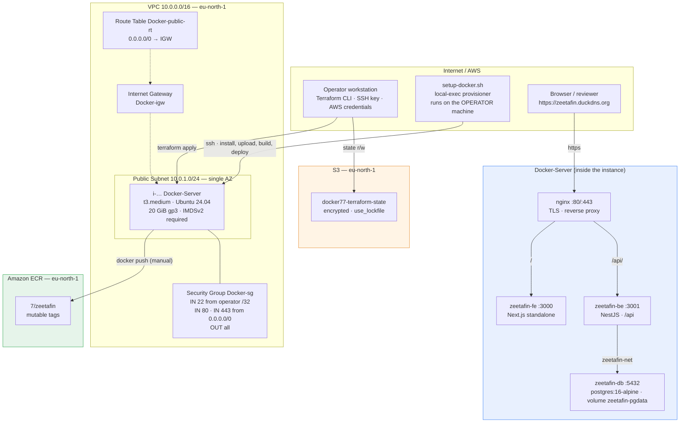

# Architecture

Why this stack is built the way it is: every resource, every stage boundary, and every
alternative that was rejected. Read this before changing a file.

- [Design brief](#design-brief)
- [What this builds](#what-this-builds)
- [The bootstrap model](#the-bootstrap-model)
- [Resource reference](#resource-reference)
- [File-by-file reference](#file-by-file-reference)
- [Networking and traffic paths](#networking-and-traffic-paths)
- [Application delivery](#application-delivery)
- [Secrets and configuration flow](#secrets-and-configuration-flow)
- [TLS and DNS](#tls-and-dns)
- [State and backend](#state-and-backend)
- [Decision log](#decision-log)
- [Alternatives rejected](#alternatives-rejected)
- [What this architecture deliberately does not do](#what-this-architecture-deliberately-does-not-do)

---

## Design brief

Phase 1 answered the question *"how do two automation paradigms differ?"* — an imperative
Bash bootstrap next to a declarative Ansible playbook. Phase 2 asks a different question:

> **How far can a single Terraform-managed host be pushed toward a real deployment before
> credentials become the only honest stopping point?**

The answer this repository commits to is: **all the way to a live HTTPS site.** The only
manual step left is the one that requires AWS credentials that must never live in Terraform —
`aws configure` and the `docker push` to ECR. Everything before that is automatic:

1. Terraform provisions a VPC, firewall, key pair, one Ubuntu 24.04 instance and an ECR
   repository.
2. A Bash bootstrap drives the instance over SSH: installs Docker and the AWS CLI, adds the
   login user to the `docker` group, uploads the tracked application source (no clone,
   no deploy keys), builds both images, generates secrets (on the first run only), deploys
   PostgreSQL + backend + frontend, and puts nginx and a Let's Encrypt certificate in front. It
   is safe to re-run: existing secrets and the certificate are preserved.
3. The operator authenticates the AWS CLI on the host once and pushes the two images to ECR.

The application is **ZeetaFin** — a NestJS backend, a Next.js frontend and a PostgreSQL
database — but the application is a payload, not the subject. The subject is the machinery
that gets it running reproducibly from a single `terraform apply`.

---

## What this builds



### At a glance

| | |
|---|---|
| **Cloud** | AWS, `eu-north-1` (Stockholm) |
| **Compute** | 1 × `t3.medium`, Ubuntu 24.04 LTS (Canonical SSM AMI), 20 GiB gp3, IMDSv2 required |
| **Network** | 1 VPC, 1 public subnet, IGW, 1 route table, security group opening 22/80/443 only |
| **Registry** | 1 ECR repository `7/zeetafin`, mutable tags |
| **DNS / TLS** | DuckDNS `zeetafin.duckdns.org` + Let's Encrypt (certbot, nginx plugin) |
| **State** | S3 bucket `docker77-terraform-state`, `encrypt = true`, `use_lockfile = true` |
| **Managed resources** | 10 (plus 3 data sources) |
| **Manual steps** | 1 — `aws configure`, `docker push` |

---

## The bootstrap model

The boundary between automation and manual steps is the most important design decision in
this repository, so it is stated explicitly and repeated everywhere.

### Stage 1 — Terraform provisions (`networking.tf`, `firewall.tf`, `compute.tf`, `ecr.tf`)

Terraform creates the VPC, IGW, subnet, route table and association, the security group, the
key pair and the instance, then the ECR repository. It stops there: it does **not** install
software on the instance, and it never sees the application source.

### Stage 2 — Bash bootstraps (`setup-docker.sh`, invoked by `bootstrap.tf`)

A `local-exec` provisioner on `terraform_data.bootstrap` runs `setup-docker.sh` **on the
operator's machine**. The script drives the instance over SSH and takes it from "bare Ubuntu"
to "application served over HTTPS". It is the entire imperative half of the build, and its
eight steps are enumerated in [DEPLOYMENT.md § The bootstrap in detail](DEPLOYMENT.md#the-bootstrap-in-detail).

### Stage 3 — Manual ECR push (the honest credential boundary)

The images exist locally on the host and the site is already live. The last step — putting
the images in ECR — needs an `aws configure` on the host followed by two `docker push`
commands. This stays manual because:

- Doing it automatically means giving the host a long-lived AWS credential (or an instance
  role with `ecr:PutImage`), and this repository deliberately refuses to place AWS
  credentials on a host that also runs a public web application. See
  [KI-15](KNOWN-ISSUES.md#ki-15).
- The push is the *learning objective*: it forces the operator to see the registry, the
  login exchange and the tag/push mechanics rather than treating ECR as a black box.

### Why a Bash script and not Ansible this time?

Phase 1 used Ansible. Phase 2 deliberately does not:

- There is **one** host. Ansible's value — idempotent fan-out across many hosts — does not
  apply, and its cost — a control node, an inventory, a playbook runtime — is pure overhead
  for a single target.
- The workload is **imperative by nature**: `scp`, `docker build`, `docker run`,
  `certbot`. There is no desired-state model to converge to; the operations are one-shot
  commands in a fixed order.
- It keeps the two phases honestly different. A reviewer comparing them sees two defensible
  answers to the same problem, not the same answer twice.

The trade-off accepted: the bootstrap is **not a declarative converge** — it is a sequenced
script. It is, however, written to be safely re-runnable: the `.env` secrets and the TLS
certificate are preserved across runs, and `-f` forces a rotation. See
[KI-09](KNOWN-ISSUES.md#ki-09) (fixed).

---

## Resource reference

Every managed resource, its file, and the one detail worth knowing.

| Resource | Type | File | Key detail |
|---|---|---|---|
| `terraform` block | backend `s3` | `providers.tf` | Bucket `docker77-terraform-state`, key `terraform.tfstate`, `encrypt = true`, `use_lockfile = true` |
| `provider.aws` | provider | `providers.tf` | `region = var.region`. No `default_tags`, no profile. |
| `data.aws_availability_zones.available` | data source | `networking.tf` | `state = "available"`. Ordered, **not** sorted; only `names[0]` is used. |
| `aws_vpc.main` | VPC | `networking.tf` | `cidr_block = var.vpc_cidr`, `enable_dns_hostnames = true` |
| `aws_internet_gateway.igw` | IGW | `networking.tf` | Attached implicitly through the public route table |
| `aws_subnet.public` | Subnet | `networking.tf` | `map_public_ip_on_launch = true`, single AZ |
| `aws_route_table.public` | Route table | `networking.tf` | `0.0.0.0/0 → IGW` |
| `aws_route_table_association.public` | Association | `networking.tf` | Subnet ↔ route table |
| `aws_security_group.ec2` | Security group | `firewall.tf` | Ingress 22 (operator `/32`), 80 and 443 (`0.0.0.0/0`); egress all |
| `data.http.my_ip` | data source | `firewall.tf` | Reads `https://checkip.amazonaws.com` for the SSH `/32` |
| `aws_key_pair.docker` | Key pair | `firewall.tf` | `key_name = "${var.project}-key"` → `Docker-key` |
| `data.aws_ssm_parameter.ubuntu` | data source | `compute.tf` | Canonical `24.04/stable/current/amd64/hvm/ebs-gp3` AMI id |
| `aws_instance.docker` | Instance | `compute.tf` | The single host: `t3.medium`, IMDSv2 required, 20 GiB gp3 encrypted |
| `aws_ecr_repository.zeetafin` | ECR repository | `ecr.tf` | `7/zeetafin`, `image_tag_mutability = "MUTABLE"`, `force_delete = true` |
| `terraform_data.bootstrap` | Provisioner trigger | `bootstrap.tf` | `triggers_replace` on host IP, domain, `app_source_revision`, and `filesha256` of script, `deploy.sh`, `nginx.cfg` |
| `local-exec` provisioner | Provisioner | `bootstrap.tf` | Invokes `bash ./setup-docker.sh` with `working_dir = path.module` |

**10 managed resources, 3 data sources.** The instance count is fixed at one — no `count`,
no autoscaling. A `count` would add list indexing and `[0]` handling to every output for a
fleet that does not exist.

> The `remote_state/` subdirectory is a **separate, self-contained root module** whose only
> job is to create the S3 bucket that `Infrastructure/` depends on. It has **no backend of
> its own** (the bootstrap paradox — the state bucket cannot store its own creation state),
> no variables and no `.tfvars`: the bucket name and region are literals in `main.tf`,
> because `Infrastructure/providers.tf`'s `backend` block cannot read `var.*` and so could
> never follow a change made here. Its state is local. See [KI-06](KNOWN-ISSUES.md#ki-06).

---

## File-by-file reference

```text
Infrastructure/                        ← the main root module; run terraform with -chdir
├── .terraform.lock.hcl                provider pins — committed on purpose
├── terraform.tfvars                   ← git-ignored, your real values
├── terraform.tfvars.example           ← committed, safe template
├── providers.tf                       terraform block, S3 backend, aws + http providers
├── variables.tf                       all 15 input variables
├── networking.tf                       VPC, IGW, subnet, route table, association
├── firewall.tf                         security group, operator-IP lookup, EC2 key pair
├── compute.tf                          Ubuntu AMI lookup, the single instance
├── ecr.tf                              the ECR repository
├── bootstrap.tf                        terraform_data + local-exec provisioner
├── outputs.tf                          10 outputs
└── setup-docker.sh                    Stage 2 — host bootstrap (Bash, ~395 lines)
```

The root module is addressed from the repository root as
`terraform -chdir=Infrastructure …`. `remote_state/` is a **separate** root module with its
own local state and is never referenced from `Infrastructure/`.

### `providers.tf`

Declares Terraform `>= 1.10` (the floor for `use_lockfile`), the `aws ~> 5.0` and
`http ~> 3.0` providers, and the S3 backend. The `http` provider exists solely for
`data.http.my_ip`; it is easy to forget and its absence produces a confusing
"provider not required" error at plan time.

### `variables.tf`

Fourteen variables in four groups: infrastructure (`region`, `vpc_cidr`,
`public_subnet_cidr`, `instance_type`, `project`), access (`public_key_file`,
`private_key_file`, `ssh_user`), registry (`ecr_namespace`, `ecr_repository_name`) and the
application/TLS group (`app_source_revision`, `duckdns_domain`,
`duckdns_token`, `letsencrypt_email`). `duckdns_token` is marked `sensitive`.

### `compute.tf`

Resolves the AMI from Canonical's SSM parameter (region-aware, never stale) and creates the
single instance. `metadata_options { http_tokens = "required" }` enforces IMDSv2;
`root_block_device` requests 20 GiB gp3, encrypted — the Docker build needs more than the
AMI's 8 GiB default.

### `firewall.tf`

Three ingress rules and one egress rule. The SSH rule's source is the operator's **current**
public IP, read at plan time from `https://checkip.amazonaws.com` and narrowed to a `/32`,
so moving networks is handled by a plain re-apply. Ports 80 and 443 are open to the world
because the site is public; the containers themselves bind to `127.0.0.1` and are never
exposed. See [SECURITY.md](SECURITY.md).

### `ecr.tf`

One repository named `${ecr_namespace}/${ecr_repository_name}` → `7/zeetafin`, with mutable
tags (so the bootstrap can push `latest` for `backend` and `frontend` repeatedly).
`force_delete = true` lets `terraform destroy` remove the repository even when it still
contains images.

### `bootstrap.tf`

The bridge between the declarative and imperative halves. A `terraform_data` resource whose
`triggers_replace` map carries the host IP, the SHA-256 of every input file, and
`app_source_revision`, so editing `setup-docker.sh`, `deploy.sh` or `nginx.cfg`, bumping the
revision, or getting a new instance automatically re-runs the provisioner on the next apply.
Optional flags (DuckDNS token, contact email) are assembled conditionally so an unset value
never appears as an empty argument.

### `setup-docker.sh`

Runs on the **operator** machine and drives the host over SSH. Eight numbered steps; see
[DEPLOYMENT.md § The bootstrap in detail](DEPLOYMENT.md#the-bootstrap-in-detail). It never stores a secret in the
repository: PostgreSQL and JWT secrets are generated on the operator with `openssl rand` and
uploaded to a `0600` `.env` on the host — **only on a fresh host**, so a re-run never desyncs
the running database. It adds the login user to the `docker` group so later steps run Docker
without `sudo`.

---

## Networking and traffic paths

| Flow | Protocol | Path |
|---|---|---|
| Operator → host | SSH/22 | Internet → IGW → public RT → host public IP. Permitted only from the operator `/32`. |
| Browser → host | HTTPS/443 | Internet → IGW → host. Terminated by nginx, proxied to `127.0.0.1:3000`/`:3001`. |
| Browser → host | HTTP/80 | Internet → IGW → host. Used for the ACME HTTP-01 challenge and a redirect to HTTPS. |
| Host → Internet | HTTPS/443 | Egress `0.0.0.0/0`. Required for `apt`, `download.docker.com`, the npm registry, DuckDNS, ECR and Let's Encrypt. |
| nginx → frontend | HTTP/3000 | Loopback only (`BIND_ADDR=127.0.0.1`, so not reachable from outside the host). |
| nginx → backend | HTTP/3001 | Loopback only. |
| backend → database | TCP/5432 | Docker network `zeetafin-net`. Never published to the host. |

The database port is **never** mapped to the host — `deploy.sh` runs the `postgres`
container on the internal Docker network with no `-p` flag, so the only way to reach it is
from inside `zeetafin-net`.

---

## Application delivery

The ZeetaFin application ships in the `Application/` tree — two complete working copies,
`Application/Backend/ZeetaFin-BE/` and `Application/Frontend/ZeetaFin-FE/`, **tracked in this
repository** alongside the infrastructure. They are the **source of truth**; the stack never
clones them from a remote. Instead:

1. `setup-docker.sh` packs each tree into a tarball, excluding `.git`, `node_modules`,
   `.next`, `dist`, `build` and `.env` (step 4/8). The excludes matter: `.env` must not cross
   the wire, and shipping `node_modules` would bloat the upload and shadow the host's own
   `npm ci`.
2. It `scp`s both tarballs to the host, then wipes and re-extracts each into
   `~/zeetafin/ZeetaFin-BE` and `~/zeetafin/ZeetaFin-FE`, so the host copy always mirrors the
   operator's working tree — including uncommitted changes.
3. It builds both images on the host. Because the source arrives by `scp`, the host needs
   **no `git`, no deploy key and no GitHub access at all**.

`app_source_revision` is an opaque marker (default `"1"`) wired into the bootstrap trigger.
Bump it and re-apply to re-upload and rebuild after editing the application — Terraform cannot
see inside the tarball, so it cannot hash the source itself.

> **Why deliver by `scp` and not `git clone`?** A clone would need a credential on the host —
> a deploy key or a token — plus the two-pass handshake to register it, and it would only
> deliver what has been committed. `scp` copies the tree from the machine running `apply` using
> the SSH key you already have, works for uncommitted files, and keeps `git` off the host
> entirely. The old deploy-key design is retained as
> [KI-10](KNOWN-ISSUES.md#ki-10) for reference.

> **Why build on the host and not in CI?** The in-repo workflow (`.github/workflows/cicd.yml`
> in the application repositories) builds and pushes to ECR on GitHub Actions. This stack
> deliberately does the build on the host instead, so the whole path is auditable from one
> `terraform apply`. The two paths are **not** in sync — see [KI-12](KNOWN-ISSUES.md#ki-12).

---

## Secrets and configuration flow

Nothing sensitive is ever committed, templated into HCL, or passed through Terraform state.

| Secret | Generated where | Lives where | How it reaches a container |
|---|---|---|---|
| PostgreSQL password | operator, `openssl rand -hex 24` | host `~/zeetafin/.env` (`0600`) | `deploy.sh` sources `.env`, passes `-e POSTGRES_PASSWORD` |
| JWT signing secret | operator, `openssl rand -hex 32` | host `~/zeetafin/.env` (`0600`) | `deploy.sh` `-e JWT_SECRET` |
| SSH private key | you, `ssh-keygen` | operator `~/.ssh/id_ed25519` | `setup-docker.sh` copies it to a `mktemp -d`, `chmod 600`, and re-verifies it with `ssh-keygen -y` |
| DuckDNS token | you (DuckDNS console) | `terraform.tfvars` (git-ignored) | passed to the script as `-t` — **this leaks** — see [KI-07](KNOWN-ISSUES.md#ki-07) |
| AWS credentials | you | operator / host `~/.aws/credentials` | manual `aws configure`; never in Terraform |

The `.env` file is written by the bootstrap and mode `0600`; `deploy.sh` refuses to start
without `POSTGRES_PASSWORD` and `JWT_SECRET` (the `: "${VAR:?…}"` guards). It is written only
on a fresh host, so re-running the bootstrap does not rotate the secrets the database already
uses — pass `-f` to rotate deliberately.

---

## TLS and DNS

The public hostname is a **DuckDNS** subdomain, `zeetafin.duckdns.org`, pointing at the
instance's auto-assigned public IP.

1. If `duckdns_token` is set, `setup-docker.sh` calls the DuckDNS update API
   (`https://www.duckdns.org/update?domains=…&token=…&ip=…`) so the record follows the new
   instance automatically. If it is not set, the operator updates the record by hand.
2. The script installs `Application/nginx.cfg` as `/etc/nginx/sites-available/zeetafin`
   (first run only — a re-run must not discard the TLS block certbot adds), substituting
   `server_name` with the configured domain, and removes the Debian default site so there is
   exactly one server block.
3. If a certificate already exists it is re-applied with `--keep-until-expiring` (no reissue,
   no DNS wait). Otherwise the script polls `getent hosts "$DOMAIN"` until it resolves to the
   instance IP (up to 30 × 10 s), then runs `certbot --nginx -d "$DOMAIN"`. certbot obtains the
   certificate over HTTP-01, installs it, and rewrites the server block to add the TLS listener
   and an HTTP→HTTPS redirect.
4. Renewal is handled by certbot's systemd timer (`certbot.timer`), which runs twice daily.

If DNS has not propagated when the poll times out, the script does **not** fail the apply:
it reports that the site is up on HTTP and the certificate is pending, and prints the exact
command to re-run the bootstrap after fixing DNS. See
[KI-05](KNOWN-ISSUES.md#ki-05) and [KI-04](KNOWN-ISSUES.md#ki-04).

> There is **no Elastic IP**. The instance's public address is reassigned every time it is
> stopped and started, which silently invalidates both the DuckDNS record and the
> certificate. This is a considered trade-off for a short-lived lab (an EIP costs
> $0.005/hr while attached and is otherwise idle), documented as
> [KI-03](KNOWN-ISSUES.md#ki-03).

---

## State and backend

- **Main module** (`Infrastructure/`) uses the S3 backend in `providers.tf`:
  bucket `docker77-terraform-state`, key `terraform.tfstate`, region `eu-north-1`,
  `encrypt = true`, and `use_lockfile = true` (native S3 locking, Terraform ≥ 1.10 — no
  DynamoDB table).
- **Bootstrap module** (`remote_state/`) creates that bucket: versioned, AES-256 encrypted,
  with all four public-access-block flags set and `force_destroy = true`. It has **no
  backend**, so its own state is a local `terraform.tfstate` — see
  [KI-06](KNOWN-ISSUES.md#ki-06).

The backend bucket name is a literal in both modules and cannot be parameterised, because a
`backend` block cannot reference variables. Two deployments that reuse the same bucket
therefore share state. This is the bootstrap paradox in miniature.

---

## Decision log

| # | Decision | Rationale | Reversibility |
|---|---|---|---|
| D1 | **Bash bootstrap, not Ansible** | One host; imperative workload (`scp`, `docker build`, `certbot`); keeps Phase 2 distinct from Phase 1. | Low — rewriting as Ansible or cloud-init is a redesign. |
| D2 | **Build images on the host** | Makes the whole path visible from one `apply`; no CI secrets to manage. | Medium — swap for the GitHub Actions workflow already in the app repos. |
| D3 | **Ship the source over SSH, not a clone** | The `Application/` tree is tracked in this repository and is the source of truth; no deploy keys, no GitHub access, no `git` on the host. | High — reintroduce `git clone` and deploy keys if the separate app repositories are made authoritative again. |
| D4 | **DuckDNS + Let's Encrypt** | A real, browser-trusted HTTPS certificate with no registrar account and no cost. | High — point a different CNAME and change `duckdns_domain`. |
| D5 | **No Elastic IP** | Saves the EIP charge for a lab that is often destroyed; the IP is regenerated on rebuild anyway. | High — add `aws_eip` and associate it. |
| D6 | **Containers bind to `127.0.0.1`** | nginx is the single public entry point; the database is never published. | Medium — `BIND_ADDR` is already a variable in `deploy.sh`. |
| D7 | **Only 22/80/443 in the security group** | The smallest set that supports SSH, ACME and the site. No 3000/3001. | High — but re-opening them weakens the design. |
| D8 | **`force_delete = true` on ECR** | `terraform destroy` should succeed without a manual repository purge. | High. |
| D9 | **`local-exec` on the operator, not `remote-exec`/user_data** | The script needs the operator's private key and drive the host end-to-end; `user_data` is fire-and-forget and cannot report progress. | Medium. |
| D10 | **Secrets generated on the operator, uploaded to a `0600` file** | Keeps `openssl rand` output off the command line and out of Terraform state. | High. |

---

## Alternatives rejected

| Alternative | Why it was rejected |
|---|---|
| **EC2 `user_data` cloud-init** to install and start everything | Fully Terraform-native, but Terraform cannot observe success, it cannot ship the operator's local source tree, and a failed run is invisible until you SSH in. |
| **`remote-exec`** instead of a local `local-exec` driver | `remote-exec` needs connection details for a host Terraform just created *and* would have to embed the whole script or reference a file the host does not yet have. |
| **NAT gateway + private subnet** | ≈ $32/month more, and the host still needs egress for `apt`, Docker and GitHub. Not worth it for a single host. |
| **A second instance for the database** | Doubles cost and adds a network hop for a workload that fits comfortably on one `t3.medium`. |
| **AWS-managed RDS instead of a `postgres` container** | Correct for production, but it is the *application* choice, not the infrastructure exercise, and it would hide the `deploy.sh` container wiring that this phase is about. |
| **ECR as the source of truth (build in CI, pull on host)** | Cleaner separation, but it requires credentials in GitHub *and* a pull credential on the host, and it makes the local `docker build` invisible. Kept as an alternative path. |
| **An IAM instance role for the ECR push** | Would remove the manual `aws configure`, but it hands the host (and anything that compromises it) standing ECR write access. The manual step is the honest boundary. |
| **`git clone` on the host with read-only deploy keys** | Needs a human with repo admin and a two-pass handshake, and it only works if every file the build needs — including the `Dockerfile` — is committed in the application repository. They were not, so the clone could not build. |
| **Elastic IP** | An extra resource and charge for an address that is reassigned on rebuild in a lab that is usually destroyed. |

---

## What this architecture deliberately does not do

- **No high availability.** One instance, one database, one pivot. Destroy it and the site
  is gone.
- **No backups.** The PostgreSQL data lives in the `zeetafin-pgdata` Docker volume on the
  root disk, which `terraform destroy` deletes. There is no snapshot schedule.
- **No CI/CD.** There is no pipeline. `setup-docker.sh` is the deployment mechanism and the
  GitHub Actions workflow in the app repos is not wired to this stack.
- **No monitoring, alerting or log aggregation.** Logs live in `docker logs` and
  `/var/log/nginx`.
- **No cost controls.** No budgets, no anomaly detection, no auto-stop.
- **No secret manager.** Secrets are files on disk and values in `terraform.tfvars`. SSM
  Parameter Store / Secrets Manager are the production answer and are out of scope.

Each of these is a legitimate review target. [REVIEW-CHECKLIST.md](REVIEW-CHECKLIST.md)
lists them as prompts.

---

## See also

- [DEPLOYMENT.md](DEPLOYMENT.md) — every command, every expected line of output.
- [OPERATIONS.md](OPERATIONS.md) — day-2 tasks, rebuild, teardown.
- [SECURITY.md](SECURITY.md) — the threat model and findings.
- [KNOWN-ISSUES.md](KNOWN-ISSUES.md) — the defect catalogue.
- [COST.md](COST.md) — what it costs to run.
