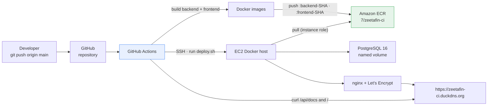

# ZeetaFin CI/CD — GitHub Actions to ECR to EC2

Phase 3 turns the Phase 2 deployment into a pipeline. A push to `main` builds both
Docker images, pushes them to Amazon ECR, SSHes into the existing EC2 host, pulls the
new tags, and replaces the running containers. The database and its volume survive the
deploy; the old application containers do not.

| | |
|---|---|
| **Cloud** | AWS, `eu-north-1` (Stockholm) |
| **Host** | `DockerCI-Server`, 1 × `t3.medium`, 20 GiB gp3, IMDSv2 required |
| **App** | ZeetaFin — the Phase 2 NestJS backend, Next.js frontend and PostgreSQL 16 |
| **Registry** | Amazon ECR `7/zeetafin-ci`, per-commit tags plus moving `latest` tags |
| **Pipeline** | `.github/workflows/deploy.yml` — test → build → scan → push → SSH → blue/green deploy → health check |
| **Host auth** | EC2 instance profile with **pull-only** ECR access. No AWS keys on the host. |
| **CI auth** | GitHub OIDC into a scoped IAM role. No static AWS keys in the repository. See [docs/CI-CD.md](docs/CI-CD.md). |
| **Deploy style** | Blue/green on one host with an atomic nginx switch and automatic rollback |
| **Trigger** | Every push to `main`, or manual `workflow_dispatch` |

> **Status:** the Terraform root module passes `terraform validate` and `terraform fmt`.
> The pipeline is written against the same application and infrastructure as Phase 2.
> Screenshots are **not committed**; see [screenshots/README.md](screenshots/README.md) for
> the exact captures to add and the redaction checklist.

---

## Table of Contents

- [What this builds](#what-this-builds)
- [Pipeline at a glance](#pipeline-at-a-glance)
- [Repository layout](#repository-layout)
- [Prerequisites](#prerequisites)
- [Quick start](#quick-start)
- [GitHub Secrets](#github-secrets)
- [How a deploy works](#how-a-deploy-works)
- [Verification](#verification)
- [Rollback](#rollback)
- [Configuration](#configuration)
- [Cost](#cost)
- [Known issues](#known-issues)
- [Documentation index](#documentation-index)
- [License](#license)

---

## What this builds



The host runs the database, one colour of the application, and nginx as a system service:

| Container | Image | Exposure |
|---|---|---|
| `zeetafin-db` | `postgres:16-alpine` | Docker network only, named volume `zeetafin-pgdata` |
| `zeetafin-be-<colour>` | `ECR:backend-<sha>` | `127.0.0.1:3001` (blue) or `:3002` (green) |
| `zeetafin-fe-<colour>` | `ECR:frontend-<sha>` | `127.0.0.1:3000` (blue) or `:3003` (green) |
| host nginx | system package | `80/443`, reverse proxy via `zeetafin-upstreams.conf` |

Only one colour runs at steady state. During a deploy the new colour starts on the
alternate ports, passes health checks, and nginx is reloaded to point at it; then the old
colour is removed.

### What changed from Phase 2

| Concern | Phase 2 | Phase 3 |
|---|---|---|
| Image build | On the EC2 host during bootstrap | On GitHub-hosted runners |
| Image transport | Manual `docker push` from the host | `docker/build-push-action` pushes to ECR |
| Deploy | Bootstrap script builds and runs containers | `deploy.sh` pulls tags and replaces containers |
| Host AWS credentials | Manual `aws configure` | EC2 instance profile, pull-only |
| Trigger | Operator runs `terraform apply` | `git push` to `main` |
| Database | Created by the bootstrap | Created by `deploy.sh` once, preserved across deploys |
| Schema changes | TypeORM `synchronize: true` | Versioned TypeORM migrations, `synchronize` disabled |
| CI auth | Manual `aws configure` | GitHub OIDC into a repository-scoped IAM role |
| Replacement | Stop-then-start, short outage | Blue/green with an atomic nginx switch, no outage |
| Rollback | Manual | Automatic on failed verification, plus manual `image_tag` |
| Image security | None at build | Trivy fails the build on fixable CRITICAL findings |
| Verification | Manual `curl` | Pipeline health check plus manual checks |

---

## Pipeline at a glance

The workflow has three jobs. `test` and `build-and-push` run on GitHub-hosted runners and
`deploy` runs only if both succeed.

| Stage | Job | What happens |
|---|---|---|
| 1. Checkout | `test` | `actions/checkout@v4` reads the application source |
| 2. Test | `test` | Backend `npm test` (Nest build + `node:test`) and frontend `tsc --noEmit` |
| 3. Authenticate | `build-and-push` | `aws-actions/configure-aws-credentials@v4` assumes `AWS_ROLE_ARN` through GitHub OIDC; no static keys |
| 4. Login | `build-and-push` | `aws-actions/amazon-ecr-login@v2` obtains a short-lived registry token |
| 5. Build and scan | `build-and-push` | Backend and frontend images are built with Buildx; Trivy fails the job on fixable CRITICAL findings before anything is pushed |
| 6. Push | `build-and-push` | Both images are pushed as `backend-<sha>` / `frontend-<sha>` plus `latest` |
| 7. SSH | `deploy` | The private key from `EC2_SSH_KEY` and the pinned `EC2_HOST_KEY` are installed |
| 8. Upload | `deploy` | The latest `Application/deploy.sh` is copied to `~/zeetafin/deploy.sh` |
| 9. Deploy | `deploy` | The host pulls both commit tags, runs migrations, starts the inactive colour, health-checks it, reloads nginx to switch, then removes the old colour |
| 10. Verify | `deploy` | The runner requests `APP_BASE_URL/api/docs` and `APP_BASE_URL/` with retries; a non-2xx response fails the job |
| 11. Record / roll back | `deploy` | On success the tag is stored as `.last_good_tag`; on failure the workflow runs `deploy.sh --rollback` |

The deploy uses the **commit SHA tags**, not `latest`. `latest` exists for convenience and
manual inspection; a deploy is always traceable to a commit.

Two copies of the pipeline exist because this repository is a collection of projects:

| File | Use it when |
|---|---|
| [`PHASE-3-CICD_Pipeline/.github/workflows/deploy.yml`](.github/workflows/deploy.yml) | The Phase 3 directory is the root of its own repository |
| [`.github/workflows/phase3-cicd.yml`](../.github/workflows/phase3-cicd.yml) | The project is run from this combined repository |

They are mirrors. Keep the step logic in sync if you edit one. See
[KI-10](docs/KNOWN-ISSUES.md#ki-10).

---

## Repository layout

```text
PHASE-3-CICD_Pipeline/
├── README.md                        ← you are here
├── LICENSE
├── CONTRIBUTING.md
├── .gitignore
├── .gitattributes                   forces LF for scripts, YAML and workflows
│
├── .github/workflows/deploy.yml     CI/CD pipeline (standalone layout)
│
├── Application/                     the Phase 2 application + blue/green deploy
│   ├── deploy.sh                    on-host ECR pull + blue/green switch + rollback
│   ├── nginx.cfg                    nginx site template (includes upstreams file)
│   ├── .env.example                 host runtime configuration template
│   ├── Backend/ZeetaFin-BE/         NestJS source + Dockerfile
│   └── Frontend/ZeetaFin-FE/        Next.js source + Dockerfile
│
├── Infrastructure/                  Terraform root module
│   ├── providers.tf                 S3 backend (phase3 bucket) + providers
│   ├── networking.tf                VPC, subnet, IGW, route table
│   ├── firewall.tf                  security group, operator-IP lookup, key pair
│   ├── compute.tf                   Ubuntu AMI and the EC2 instance
│   ├── iam.tf                       pull-only ECR role + instance profile
│   ├── github_oidc.tf               GitHub OIDC provider + ECR push role for CI
│   ├── ecr.tf                       repository + scan-on-push + lifecycle policy
│   ├── bootstrap.tf                 terraform_data + local-exec provisioner
│   ├── setup-docker.sh              host bootstrap: Docker, nginx, TLS, .env
│   ├── ci-ecr-push.example.json     minimum ECR push policy (static-key fallback)
│   ├── variables.tf
│   ├── terraform.tfvars.example
│   └── outputs.tf                   values for the GitHub Secrets
│
├── remote_state/                    separate root module: S3 state bucket
├── docs/
│   ├── ARCHITECTURE.md
│   ├── CI-CD.md
│   ├── DEPLOYMENT.md
│   ├── OPERATIONS.md
│   ├── SECURITY.md
│   ├── KNOWN-ISSUES.md
│   └── REVIEW-CHECKLIST.md
└── screenshots/
    └── README.md                    capture list and redaction rules
```

The application source is the Phase 2 tree. It is committed here because each project in
this repository is self-contained; Phase 3 does not import files from Phase 2 at runtime.

---

## Prerequisites

| Requirement | Version | Notes |
|---|---|---|
| Terraform CLI | ≥ 1.10 | `use_lockfile` needs 1.10+ |
| AWS credentials | — | For `terraform apply`; prefer SSO or a role |
| Permissions to apply | — | `ec2:*`, `ecr:*`, `iam:*`, `s3:*` on the state bucket |
| SSH key pair | ed25519 | Public key is uploaded to EC2; private key goes into `EC2_SSH_KEY` |
| GNU bash | ≥ 4.4 | `setup-docker.sh` and `deploy.sh` run under Git Bash, WSL, Linux or macOS |
| Docker | any | Only needed if you want to build images locally |
| GitHub repository | — | Actions enabled; a `production` environment is optional but recommended |
| DuckDNS account | free | Owns the hostname nginx serves (or use your own DNS) |

---

## Quick start

All commands are from the project root (the directory that contains `Application/` and
`Infrastructure/`).

### Step 1 — Bootstrap the state bucket

```bash
cd remote_state
terraform init
terraform apply -auto-approve
cd ..
```

This creates `docker77-phase3-terraform-state`: versioned, encrypted and with all four
public-access-block flags set.

### Step 2 — Configure and apply the infrastructure

```bash
cp Infrastructure/terraform.tfvars.example Infrastructure/terraform.tfvars
# edit Infrastructure/terraform.tfvars
# GitHub-hosted runners need SSH from their dynamic addresses; the example
# sets ssh_ingress_cidrs = ["0.0.0.0/0"]. Narrow it if you use a self-hosted
# runner. See docs/SECURITY.md.
terraform -chdir=Infrastructure init
terraform -chdir=Infrastructure plan
terraform -chdir=Infrastructure apply
```

The apply creates the VPC, EC2 instance, IAM role, ECR repository and the host bootstrap.
The bootstrap installs Docker, AWS CLI v2, nginx and certbot, writes `~/zeetafin/.env`,
and configures nginx and TLS. It does **not** start the application.

At this point the host is ready but the URL returns `502` until the first pipeline run.
See [docs/DEPLOYMENT.md](docs/DEPLOYMENT.md) for the full walkthrough.

### Step 3 — Read the values for GitHub Secrets

```bash
terraform -chdir=Infrastructure output -raw github_secret_values
terraform -chdir=Infrastructure output -raw ecr_repository_name
terraform -chdir=Infrastructure output -raw ecr_registry
terraform -chdir=Infrastructure output -raw server_public_ip
```

### Step 4 — Configure GitHub Secrets

In the GitHub repository: **Settings → Secrets and variables → Actions → New repository
secret**. Add every value in the [GitHub Secrets](#github-secrets) table. The pipeline
cannot run without them.

### Step 5 — Push the application

```bash
git add .
git commit -m "Deploy ZeetaFin through the pipeline"
git push origin main
```

A push to `main` starts the workflow. Watch **Actions → Build, Push to
ECR and Deploy to EC2**. The deploy job finishes only after the host answers at
`APP_BASE_URL/api/docs` and `APP_BASE_URL/`.

### Step 6 — Verify

```bash
curl -fsS https://zeetafin-ci.duckdns.org/api/docs >/dev/null && echo "API up"
curl -fsS https://zeetafin-ci.duckdns.org/ >/dev/null && echo "Frontend up"
curl -sI https://zeetafin-ci.duckdns.org | head -1
```

---

## GitHub Secrets

Add these as **repository secrets**. Nothing in this list belongs in the repository.

| Secret | Source | Required | Purpose |
|---|---|---|---|
| `AWS_ROLE_ARN` | `terraform output -raw github_oidc_role_arn` | ✅ | Role assumed by the build job through GitHub OIDC |
| `AWS_REGION` | `terraform output -raw aws_region` | ✅ | ECR region |
| `ECR_REGISTRY` | `terraform output -raw ecr_registry` | ✅ | `docker login` and image names |
| `ECR_REPOSITORY` | `terraform output -raw ecr_repository_name` | ✅ | Repository path, for example `7/zeetafin-ci` |
| `EC2_HOST` | `terraform output -raw server_public_ip` | ✅ | SSH target |
| `EC2_HOST_KEY` | `ssh-keyscan -H <server_public_ip>` | ✅ | Pins the host identity for the deploy job |
| `EC2_USER` | `terraform output -raw ssh_user` | ✅ | SSH user, normally `ubuntu` |
| `EC2_SSH_KEY` | contents of `~/.ssh/id_ed25519` | ✅ | SSH private key, no passphrase |
| `APP_BASE_URL` | `terraform output -raw app_url` | ✅ | Health-check base URL, no trailing slash |
| `NEXT_PUBLIC_API_URL` | optional, default `/api` | ❌ | Frontend build-time API path |

There are **no** `AWS_ACCESS_KEY_ID` / `AWS_SECRET_ACCESS_KEY` secrets. The build job
assumes `AWS_ROLE_ARN` through OIDC, and the trust policy accepts only a token from this
repository on the `main` branch. The role's inline policy grants ECR push to the single
Phase 3 repository and nothing else. See
[`Infrastructure/github_oidc.tf`](Infrastructure/github_oidc.tf).

> If OIDC is unavailable, the same push policy is in
> [`Infrastructure/ci-ecr-push.example.json`](Infrastructure/ci-ecr-push.example.json) for a
> static-key fallback. That path reintroduces [KI-01](docs/KNOWN-ISSUES.md#ki-01) and is not
> the default.

Generate the host key secret after the instance exists:

```bash
ssh-keyscan -H "$(terraform -chdir=Infrastructure output -raw server_public_ip)"
```

Paste the full line as `EC2_HOST_KEY`. The deploy job refuses a key that does not cover
`EC2_HOST`, so a replaced instance fails loudly instead of being trusted blindly.

The EC2 host does **not** receive these secrets. It authenticates to ECR through its
instance profile, which grants only `GetAuthorizationToken` and the three pull actions on
the Phase 3 repository.

---

## How a deploy works

1. **The developer pushes.** Every push to `main` triggers the workflow.
   `workflow_dispatch` allows a manual run and an optional tag override.
2. **Tests run first.** The `test` job builds the backend and runs its `node:test` suite,
   then typechecks the frontend. A failure stops the pipeline before anything is built.
3. **GitHub builds and scans.** The runner assumes `AWS_ROLE_ARN` through OIDC, logs in to
   ECR, and builds both images. Trivy scans each image and fails the job on fixable
   CRITICAL findings **before** the push. Buildx caches layers in GitHub Actions cache.
4. **Images are pushed.** Each commit produces
   `…/7/zeetafin-ci:backend-<sha>` and `…/7/zeetafin-ci:frontend-<sha>`, plus `latest`
   aliases. The job summary lists the pushed tags.
5. **The deploy job connects.** It installs `EC2_SSH_KEY` and the pinned `EC2_HOST_KEY`,
   then copies the latest `Application/deploy.sh` to `~/zeetafin/deploy.sh`.
6. **The host pulls.** `deploy.sh` calls `aws ecr get-login-password` through the instance
   role, logs Docker in to ECR, and pulls both commit tags. If either pull fails, the old
   colour keeps serving.
7. **The new colour starts and is checked.** The inactive colour (green if blue is active)
   starts on its own port pair. Its backend container runs migrations, then the script
   polls the new colour directly until it answers.
8. **nginx is switched atomically.** The script rewrites
   `/etc/nginx/zeetafin-upstreams.conf`, validates it with `nginx -t`, and reloads nginx.
   If validation or the reload fails, the previous upstreams are restored. Only then is the
   old colour removed. The PostgreSQL container and its volume are never touched.
9. **The runner verifies.** The final step requests `APP_BASE_URL/api/docs` and
   `APP_BASE_URL/` from outside AWS. On success the deployed tag is recorded in
   `~/zeetafin/.last_good_tag`. On failure the workflow runs `deploy.sh --rollback`.

Schema changes ship as versioned TypeORM migrations that run before the app starts;
`synchronize` is disabled.

---

## Verification

### Pipeline-side

```text
GitHub → Actions → Build, Push to ECR and Deploy to EC2
  ✓ build-and-push   Build images and push to ECR
  ✓ deploy           Deploy to EC2
```

The deploy step's log should contain:

```text
Logging in to ECR registry <account>.dkr.ecr.eu-north-1.amazonaws.com
Pulling ...:backend-<sha>
Pulling ...:frontend-<sha>
Active colour is blue; deploying green on ports 3002/3003
Running migrations
Green backend is up
Green frontend is up
Switching nginx upstreams to green
Removing the blue containers
Deployed <sha> successfully.
```

### Registry-side

```bash
aws ecr describe-images --repository-name 7/zeetafin-ci \
  --query 'sort_by(imageDetails, &imagePushedAt)[*].[imageTags[0], imagePushedAt]' \
  --output table
```

### Host-side

```bash
ssh -i ~/.ssh/id_ed25519 ubuntu@$(terraform -chdir=Infrastructure output -raw server_public_ip)

docker ps --format 'table {{.Names}}\t{{.Status}}\t{{.Ports}}'
cd ~/zeetafin && cat .active_color .deployed_tag .last_good_tag
docker inspect --format '{{.Config.Image}}' "zeetafin-be-$(cat ~/zeetafin/.active_color)"
docker logs --tail 40 "zeetafin-be-$(cat ~/zeetafin/.active_color)"
sudo nginx -t && cat /etc/nginx/zeetafin-upstreams.conf
sudo certbot certificates
```

`docker inspect` should show the same commit SHA that the workflow pushed, and
`.active_color` names the colour nginx is serving.

### Site-side

```bash
dig +short zeetafin-ci.duckdns.org
curl -sI https://zeetafin-ci.duckdns.org | head -1
curl -s  https://zeetafin-ci.duckdns.org/api/docs | head
```

### Terraform-side

```bash
terraform fmt -check -recursive
terraform -chdir=Infrastructure validate
terraform -chdir=Infrastructure state list
```

---

## Rollback

There are two paths.

**Automatic.** If the host deploy succeeds but the runner's external health check fails,
the workflow SSHes back and runs `deploy.sh --rollback`. That prefers the last externally
verified tag (`~/zeetafin/.last_good_tag`), falls back to `.previous_tag`, and deploys it
into the inactive colour so there is no gap.

**Manual.** To return to any earlier commit:

1. Find the previous successful commit SHA in the workflow history.
2. Run **Actions → Build, Push to ECR and Deploy to EC2 → Run workflow** and set
   `image_tag` to that SHA. The images are still in ECR unless the lifecycle policy has
   expired them.
3. Alternatively, on the host:

```bash
cd ~/zeetafin
AWS_REGION=eu-north-1 \
ECR_REGISTRY=<registry> \
ECR_REPOSITORY=7/zeetafin-ci \
bash deploy.sh --rollback
```

The lifecycle policy keeps the ten most recent images per prefix, so old SHAs eventually
expire. Ten deploys is the practical rollback window.

---

## Configuration

Variables live in [`Infrastructure/variables.tf`](Infrastructure/variables.tf) and values
come from `Infrastructure/terraform.tfvars`.

| Variable | Type | Default | Description |
|---|---|---|---|
| `region` | `string` | — (required) | AWS region for provider, backend and ECR |
| `vpc_cidr` | `string` | — (required) | VPC CIDR |
| `public_subnet_cidr` | `string` | — (required) | Single public subnet CIDR |
| `instance_type` | `string` | — (required) | EC2 type; `t3.medium` recommended |
| `project` | `string` | — (required) | Prefix for tags, SG, key pair and IAM role |
| `ecr_namespace` | `string` | — (required) | ECR namespace, for example `7` |
| `ecr_repository_name` | `string` | — (required) | ECR repository, for example `zeetafin-ci` |
| `ssh_user` | `string` | `ubuntu` | Login user |
| `ssh_ingress_cidrs` | `list(string)` | `[]` | Extra SSH sources. GitHub-hosted runners need `["0.0.0.0/0"]`; see [Security](docs/SECURITY.md). |
| `github_repository` | `string` | project repo | Repository the OIDC role trusts; change for a fork |
| `github_branch` | `string` | `main` | Branch the OIDC role trusts |
| `public_key_file` | `string` | `~/.ssh/id_ed25519.pub` | Uploaded to the EC2 key pair |
| `private_key_file` | `string` | `~/.ssh/id_ed25519` | Used by the bootstrap provisioner |
| `duckdns_domain` | `string` | `zeetafin.duckdns.org` | Hostname nginx serves and certbot certifies |
| `duckdns_token` | `string` (sensitive) | `""` | Optional DuckDNS API token |
| `letsencrypt_email` | `string` | `""` | Optional certbot contact |

Outputs that feed GitHub Secrets: `github_secret_values`, `github_oidc_role_arn`,
`ecr_repository_name`, `ecr_registry`, `server_public_ip`, `ssh_user`, `app_url` and
`aws_region`.

---

## Cost

Approximate `eu-north-1` list prices, running 24×7:

| Item | Monthly |
|---|---|
| `t3.medium` | ≈ $33 |
| Public IPv4 | ≈ $3.65 |
| 20 GiB gp3 | ≈ $1.76 |
| ECR storage (a few hundred MB) | ≈ $0.10–$1 |
| GitHub Actions (public repo) | $0 |
| **Total** | **≈ $39** |

`t3.small` roughly halves the compute cost now that CI builds the images. Destroy the
stack between sessions for $0. See [docs/OPERATIONS.md](docs/OPERATIONS.md#teardown).

---

## Known issues

The full list is in [docs/KNOWN-ISSUES.md](docs/KNOWN-ISSUES.md). The ones that matter
before treating this as production:

1. **[KI-04](docs/KNOWN-ISSUES.md#ki-04)** — one host runs the app, the database and the
   proxy; there are no backups.
2. **[KI-09](docs/KNOWN-ISSUES.md#ki-09)** — the example opens SSH to `0.0.0.0/0` so
   GitHub-hosted runners can deploy.
3. **[KI-11](docs/KNOWN-ISSUES.md#ki-11)** — no Elastic IP; a stop/start changes the
   public IP and breaks `EC2_HOST`, DNS and renewal.
4. **[KI-10](docs/KNOWN-ISSUES.md#ki-10)** — the root and standalone workflow files are
   duplicates and can drift.
5. **[KI-14](docs/KNOWN-ISSUES.md#ki-14)** — ECR tags are mutable, so a tag can be moved.
6. **[KI-07](docs/KNOWN-ISSUES.md#ki-07)** — the DuckDNS token can leak into the process
   list and Terraform logs.

Issues **fixed** in this repository: KI-01 (OIDC), KI-02 (pinned host key), KI-03
(automatic rollback), KI-05 (blue/green), KI-06 (migrations) and KI-12 (no tests or image
scan).

---

## Documentation index

| Document | Read it to… |
|---|---|
| [docs/CI-CD.md](docs/CI-CD.md) | understand every workflow step, secret and failure mode |
| [docs/ARCHITECTURE.md](docs/ARCHITECTURE.md) | see the resource graph and the design decisions |
| [docs/DEPLOYMENT.md](docs/DEPLOYMENT.md) | deploy from scratch, with expected output |
| [docs/OPERATIONS.md](docs/OPERATIONS.md) | redeploy, roll back, rotate secrets, tear down |
| [docs/SECURITY.md](docs/SECURITY.md) | review the threat model and IAM boundaries |
| [docs/KNOWN-ISSUES.md](docs/KNOWN-ISSUES.md) | see what is deliberately imperfect |
| [docs/REVIEW-CHECKLIST.md](docs/REVIEW-CHECKLIST.md) | run a structured review of the pipeline |
| [screenshots/README.md](screenshots/README.md) | capture and redact the required evidence |

---

## Evidence to add

The deliverable asks for screenshots. This repository does not fabricate them. Capture:

1. The green GitHub Actions run, both jobs visible.
2. The ECR console or `aws ecr describe-images` output showing the pushed tags.
3. `docker ps` on the host showing the three application containers, plus `systemctl status nginx`.
4. The application in a browser over HTTPS.

Follow the redaction rules in [screenshots/README.md](screenshots/README.md) before
committing. Never commit account IDs, ARNs, public IPs, instance IDs or key material.

---

## License

MIT. See [LICENSE](LICENSE).
