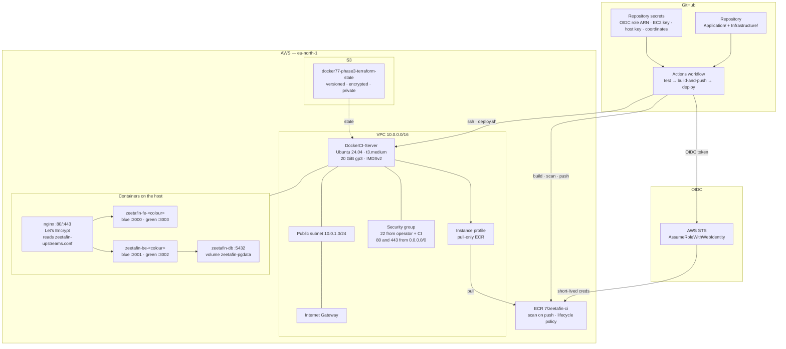

# Architecture

Phase 3 keeps the Phase 2 runtime topology and moves the build and release path into
GitHub Actions. This document describes the resources, the trust boundaries, and the
decisions behind them.

---

## Resource graph



---

## Resources

| Resource | Type | File | Notes |
|---|---|---|---|
| `terraform` backend | S3 | `providers.tf` | `docker77-phase3-terraform-state`, key `phase3/terraform.tfstate`, native lockfile |
| `aws_vpc.main` | VPC | `networking.tf` | `/16`, DNS hostnames enabled |
| `aws_internet_gateway.igw` | IGW | `networking.tf` | Public egress |
| `aws_subnet.public` | Subnet | `networking.tf` | Single AZ, public IP on launch |
| `aws_route_table.public` | Route table | `networking.tf` | `0.0.0.0/0 → IGW` |
| `aws_security_group.ec2` | Security group | `firewall.tf` | 22 from operator `/32` plus `ssh_ingress_cidrs`, 80/443 from anywhere, all egress |
| `data.http.my_ip` | Data source | `firewall.tf` | Operator public IP from `checkip.amazonaws.com` |
| `aws_key_pair.docker` | Key pair | `firewall.tf` | Public key from `public_key_file` |
| `data.aws_ssm_parameter.ubuntu` | Data source | `compute.tf` | Canonical Ubuntu 24.04 gp3 AMI |
| `aws_instance.docker` | Instance | `compute.tf` | IMDSv2 required, encrypted 20 GiB root, instance profile attached |
| `aws_iam_role.ec2_ecr_pull` | IAM role | `iam.tf` | Trusted by `ec2.amazonaws.com` |
| `aws_iam_role_policy.ec2_ecr_pull` | IAM policy | `iam.tf` | `GetAuthorizationToken` + pull on the Phase 3 repository only |
| `aws_iam_instance_profile.docker` | Instance profile | `iam.tf` | Attached to the instance |
| `aws_iam_openid_connect_provider.github` | OIDC provider | `github_oidc.tf` | `token.actions.githubusercontent.com`, audience `sts.amazonaws.com` |
| `aws_iam_role.github_ecr_push` | IAM role | `github_oidc.tf` | Assumed by GitHub Actions; trust scoped to one repo and branch |
| `aws_iam_role_policy.github_ecr_push` | IAM policy | `github_oidc.tf` | ECR push to the Phase 3 repository only |
| `aws_ecr_repository.zeetafin` | ECR repository | `ecr.tf` | Mutable tags, scan on push, force delete |
| `aws_ecr_lifecycle_policy.zeetafin` | ECR lifecycle | `ecr.tf` | Keep 10 per image prefix; expire untagged after 7 days |
| Blue/green slots | Host state | `Application/deploy.sh` | `zeetafin-be-blue/-green`, `zeetafin-fe-blue/-green`; nginx reads `/etc/nginx/zeetafin-upstreams.conf` |
| `terraform_data.bootstrap` | Provisioner trigger | `bootstrap.tf` | Re-runs when host, scripts or domain change |
| `local-exec` provisioner | Provisioner | `bootstrap.tf` | `bash ./setup-docker.sh …` on the operator machine |

`remote_state/` is a separate root module that creates the state bucket. It has no backend
of its own and uses local state; that is the bootstrap paradox, documented in
[KNOWN-ISSUES.md § KI-08](KNOWN-ISSUES.md#ki-08).

---

## Trust boundaries

| Boundary | Credential | Scope | Lifetime |
|---|---|---|---|
| Developer → GitHub | GitHub account / SSH key | Repository write | User-controlled |
| GitHub Actions → AWS | OIDC token → `AWS_ROLE_ARN` | ECR push to one repository | Minutes, per job |
| GitHub Actions → EC2 | `EC2_SSH_KEY` + pinned `EC2_HOST_KEY` | SSH as `ubuntu` | Long-lived key with a pinned host identity |
| EC2 → ECR | Instance profile via IMDSv2 | ECR pull from one repository | Rotated automatically by AWS |
| Browser → EC2 | None | HTTPS 443 | Session |
| Operator → EC2 | SSH key | SSH 22 from the operator `/32` | Key lifetime |

The important change from Phase 2 is that the **host no longer needs AWS user
credentials**. It receives only a role that can pull the one repository. The CI runner is
the only place with push authority, and it holds no stored credential at all: it exchanges
a GitHub OIDC token for short-lived STS credentials scoped to ECR.

The ECR token the host obtains is valid for 12 hours. Docker stores it in
`~/.docker/config.json`; it expires without a refresh. Every deploy obtains a fresh token,
so an idle host simply cannot pull until the next deploy logs in again.

---

## State and naming

| Item | Value | Why |
|---|---|---|
| State bucket | `docker77-phase3-terraform-state` | Separate from Phase 1 and Phase 2 buckets |
| State key | `phase3/terraform.tfstate` | Leaves room for future stacks in the same bucket |
| Project prefix | `DockerCI` | Avoids the Phase 2 key pair and IAM role names |
| ECR repository | `7/zeetafin-ci` | Avoids colliding with the Phase 2 `7/zeetafin` repository |
| Hostname | `zeetafin-ci.duckdns.org` | Independent certificate and DNS record |

If you run Phase 2 and Phase 3 in the same account, keep these values distinct. The key
pair name and ECR repository are account/region-level names and cannot be shared.

---

## Build and release path

### Build

GitHub-hosted `ubuntu-latest` runners execute the workflow. Docker Buildx builds:

| Image | Context | Dockerfile | Build args |
|---|---|---|---|
| Backend | `Application/Backend/ZeetaFin-BE` | multi-stage Node 20 Alpine | none |
| Frontend | `Application/Frontend/ZeetaFin-FE` | multi-stage Node 20 Alpine, standalone output | `NEXT_PUBLIC_API_URL` (default `/api`) |

Both Dockerfiles already existed in Phase 2 and are unchanged. The only new build input is
the API URL passed to the frontend at build time. Because the browser calls the same origin
(`/api`), the default works behind nginx.

### Release

The deploy job never builds. It uploads the deploy script and invokes it with four values:

```text
AWS_REGION, ECR_REGISTRY, ECR_REPOSITORY, IMAGE_TAG
```

Those values come from GitHub Secrets and the commit SHA. The host derives the full image
references:

```text
$ECR_REGISTRY/$ECR_REPOSITORY:backend-$IMAGE_TAG
$ECR_REGISTRY/$ECR_REPOSITORY:frontend-$IMAGE_TAG
```

### Blue/green on one host

Two colour slots run on distinct loopback ports. nginx includes an upstream file that
deploy.sh rewrites:

```text
upstream zeetafin_backend  { server 127.0.0.1:3001; }  # blue  → 3002 for green
upstream zeetafin_frontend { server 127.0.0.1:3000; }  # blue  → 3003 for green
```

A deploy starts the inactive colour, waits for it to answer directly, validates the new
upstream file with `nginx -t`, reloads nginx, then removes the old colour. The reload is
the switch: in-flight requests on the old colour finish before its containers are removed,
so there is no stop-then-start gap. State lives in `.active_color`, `.deployed_tag`,
`.previous_tag` and `.last_good_tag` under `~/zeetafin`.

### Schema changes

The backend image runs `node dist/migrate.js` before the seed and the app. Migrations are
TypeORM classes under `src/migrations/`; `synchronize` is disabled. The baseline migration
is written to be idempotent so it can adopt a database that an earlier `synchronize: true`
run already created.

### Bootstrap boundary

Terraform still runs `setup-docker.sh` from the operator machine. That script exists
because Terraform cannot observe the success of cloud-init, and the host needs packages,
nginx, a certificate and a generated `.env` before it can accept a deploy. It stops before
building or starting the application: that is now a pipeline responsibility.

The bootstrap is idempotent:

- `.env` is written only when absent, so re-running does not rotate the database password.
- The nginx site is installed only on first run; afterwards certbot owns the 443 block.
- An existing certificate is reused with `--keep-until-expiring`.
- Docker and AWS CLI installation are skipped when the commands already exist.

---

## Network flows

| Flow | Protocol | Path |
|---|---|---|
| Developer → GitHub | HTTPS | Internet |
| GitHub runner → AWS APIs | HTTPS 443 | GitHub egress |
| GitHub runner → EC2 | SSH key | SSH 22 from the CIDRs in `ssh_ingress_cidrs`; the example opens it to `0.0.0.0/0` |
| GitHub runner → application | HTTPS 443 | Internet → nginx |
| Host → ECR | HTTPS 443 | Egress via IGW, authenticated by instance role |
| Host → Internet | HTTPS 443 | apt, Docker Hub, Let's Encrypt, DuckDNS |
| Browser → host | HTTPS 443 | Internet → nginx |
| Browser → host | HTTP 80 | ACME HTTP-01 and HTTP→HTTPS redirect |
| nginx → app | HTTP 3000–3003 | Loopback only; only the active colour is upstream |
| backend → database | TCP 5432 | Docker network `zeetafin-net` |

### Important SSH caveat

The security group always allows the operator's public IP `/32`, resolved when
`terraform apply` last ran. GitHub-hosted runners use different egress addresses on every
run, so they cannot use that rule alone. `ssh_ingress_cidrs` adds further sources; the
example tfvars sets it to `0.0.0.0/0` so a GitHub-hosted runner can reach port 22.

That is a deliberate lab trade-off, not a production recommendation. Key-only SSH is the
only control on port 22 in this configuration: there is no fail2ban, no port knocking and
no source pinning. Better options, in order:

1. Use a self-hosted runner and set `ssh_ingress_cidrs` to its CIDR.
2. Replace SSH with AWS Systems Manager Session Manager or an EC2 Instance Connect
   Endpoint, then remove port 22 from the public security group.
3. Pin GitHub's published runner ranges (they change, and Terraform churn follows).

See [KNOWN-ISSUES.md § KI-09](KNOWN-ISSUES.md#ki-09).

---

## Design decisions

| Decision | Rationale | Alternative rejected |
|---|---|---|
| Build in CI, not on the host | Removes build load and toolchain from the host, makes images reproducible and traceable | Building on the host (Phase 2) |
| Push commit-addressable tags | A deploy can be traced to a commit and repeated | `latest` only |
| Host pulls with an instance profile | No AWS keys on the server | `aws configure` with long-lived keys (Phase 2) |
| Keep `latest` tags | Useful for manual inspection and quick demos | Only commit tags |
| ECR lifecycle policy | Bounds storage without manual cleanup | Keeping every image forever |
| Preserve the DB container | A deploy should not restart the database | Recreating all containers on every deploy |
| Blue/green on one host | Removes the stop-then-start gap without a load balancer | Stop-then-start (Phase 2), multi-host canary |
| Migrations over `synchronize` | Schema changes are reviewed and repeatable | Auto-sync (Phase 2) |
| Trivy gates the push | A critical image never reaches ECR | Scan after push, or ECR scan only |
| Health check in both places | Host catches container startup; runner catches DNS/TLS/nginx | Runner only (too late to debug), host only (misses external failure) |
| Separate state bucket | No collision with Phase 1 and 2 | Shared bucket and key |
| Mirror workflow files | Each layout is directly usable | One file with conditional path prefixes (fragile) |

---

## What is deliberately out of scope

- Terraform execution from CI. The pipeline assumes the stack already exists.
- Multi-AZ, load balancing, autoscaling and a managed database.
- Canary or percentage-based rollout. Blue/green is all-or-nothing on one host.
- Database backups, point-in-time recovery and migration dry-runs.
- Image signing, SBOM attestation and policy enforcement.
- Secrets management beyond GitHub Secrets and the instance profile.

These are listed in [KNOWN-ISSUES.md](KNOWN-ISSUES.md) with severity and a suggested fix.
